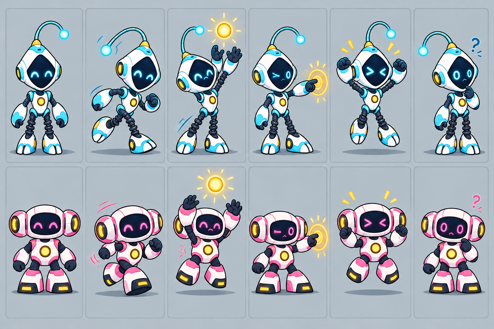
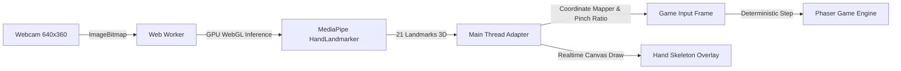

<div align="center">

<p align="center">
  <a href="https://github.com/fudever-club" target="_blank" rel="noopener noreferrer">
    
  </a>
</p>

# ⚡ REACTOR RUSH — THREE-ROUND MISSION ⚡

[](https://github.com/fudever-club)
[](https://phaser.io/)
[](https://ai.google.dev/edge/mediapipe/solutions/vision/hand_landmarker)
[](https://www.typescriptlang.org/)
[](https://vitejs.dev/)

**Trò chơi tương tác 2D thời gian thực, tích hợp thị giác máy tính AI (Computer Vision) điều khiển bằng cử chỉ qua Webcam hoặc Bàn phím.**  
*Một sản phẩm nghiên cứu & phát triển bởi **CLB Lập trình FU-DEVER** — Trường Đại học FPT Đà Nẵng.*

<p align="center">
  
</p>

[Trải nghiệm ngay](#-cài-đặt--khởi-chạy-dự-án) • [Cơ chế điều khiển](#-hướng-dẫn-điều-khiển) • [Luật chơi & Tính điểm](#-luật-chơi--cách-tính-điểm) • [Kiến trúc kỹ thuật](#-kiến-trúc-hệ-thống--công-nghệ) • [Về FU-DEVER](#-về-câu-lạc-bộ-lập-trình-fu-dever)

</div>

---


## Campaign ba ải — cập nhật 21/10/2026

**Energy Catch → Duo Circuit → Cool the Core**, mỗi ải 60 giây. Có hướng dẫn và kết quả từng ải, bảng tổng kết toàn game và chơi lại từ đầu. Solo chỉ tính P1; Co-op cộng hai người.

- **Energy Catch:** luật bắt năng lượng/hazard và combo hiện có giữ nguyên.
- **Duo Circuit:** đứng ở vùng nút đang sáng, giữ kích hoạt 1 giây để nối; thả rồi mới nối tiếp. +100 mỗi nút, +200 cho một mạch ba nút.
- **Cool the Core:** đến van đang hoạt động, giữ kích hoạt khi an toàn để làm mát; thả khi báo quá tải. Nhiệt còn lại hiển thị ở tổng kết.
- **Pose Both Arms [P1]:** nghiêng thân để đi, giơ cả hai tay để Catch/Activate; thả tay một lần khi vào ải mới. H0/P2 và bàn phím vẫn có sẵn. Camera được giữ xuyên chuyển ải khi đã opt-in; STOP CAMERA dừng camera và chọn bàn phím.

[Đặc tả gameplay](docs/gameplay/three-round-campaign.md) · [Luồng màn hình](docs/design/screen-flow-and-round-map.md) · [Báo cáo kiểm thử và giới hạn](docs/reports/three-round-campaign-2026-10-21.md). Đây là bản kỹ thuật cục bộ; kiểm thử webcam vật lý đủ ba ải, TV và cold-start ngắt mạng thật vẫn cần bằng chứng riêng.

## 📖 Giới thiệu tổng quan

**Reactor Rush** là game web arcade gồm ba ải liên tiếp, được phát triển nhằm thử nghiệm và tối ưu hóa việc kết hợp giữa **Game Engine 2D (Phaser)** và **Mô hình thị giác máy tính (MediaPipe Pose/Hand Landmarker)** chạy trực tiếp trên trình duyệt.

Game mang đến trải nghiệm điều khiển đa phương thức đột phá:
- **Motion Control (Cử chỉ thân người/bàn tay)**: Ba scheme webcam thử nghiệm: Hand Pinch H0, Pose Both Arms P1 và Pose One Arm P2. Có GPU delegate và CPU fallback; độ trễ, FPS và khoảng cách sử dụng trên laptop booth chưa được đo.
- **Keyboard Control (Bàn phím truyền thống)**: Mượt mà, nhạy bén và là phương án dự phòng chuẩn chỉ.

---

## 🌟 Tính năng nổi bật

- 🕹️ **2 Chế độ chơi linh hoạt**:
  - **1 Player (Solo)**: Thử thách phản xạ cá nhân với nhân vật P1 (Cyan).
  - **2 Players (Co-op)**: Hai người chơi cùng đứng trước camera hoặc cùng bàn phím phối hợp bắt năng lượng chia làn đối xứng.
- 🖐️ **Camera tracking qua Web Worker**:
  - Inference chạy trong **Web Worker**; chi phí CPU/GPU và ảnh hưởng tới vòng game vẫn cần đo trên thiết bị đích.
  - **GPU Acceleration (WebGL)** và CPU fallback một lần khi inference GPU quá hạn. Cần hiệu chuẩn lại sau khôi phục; hiệu năng thực tế chưa được nghiệm thu.
  - **Visual Landmark Skeleton Overlay**: Hiển thị khung xương và 21 khớp bàn tay thời gian thực với mã màu trực quan (Cyan cho P1, Pink cho P2).
  - **Pinch-to-Catch**: Ánh xạ cử chỉ chụm ngón cái/ngón trỏ sang Catch và hiển thị phản hồi; độ chính xác thực tế cần được đo trong FIELD-01.
  - Cơ chế **Hiệu chuẩn (Calibration)** thông minh lưu trữ tọa độ trung tính của người chơi trước khi bắt đầu.
- 🤖 **2D Cutout Rig Animation**:
  - Hệ thống nhân vật robot P1 Cyan & P2 Pink chuyển động mượt mà qua các trạng thái: *Idle, Move, Catch*.
  - Có trang kiểm thử hoạt ảnh chuyên biệt tại `/animation-test.html`.
- ⚡ **Hệ thống Combo & Tính điểm cuốn hút**:
  - Chuỗi combo liên tiếp giúp nhân hệ số điểm thưởng lên tới **3.0×**.
  - Hiểm họa trừ điểm có cơ chế chống âm và thông báo phản hồi rõ ràng.

---

## 🎮 Hướng dẫn điều khiển

### 1. Bàn phím (Keyboard Controls)

| Người chơi | Di chuyển trái / phải | Bắt năng lượng (Catch) |
|---|---|---|
| **Player 1 (Cyan)** | <kbd>A</kbd> / <kbd>D</kbd> | Giữ <kbd>S</kbd> khi năng lượng chạm tới robot |
| **Player 2 (Pink)** | <kbd>←</kbd> / <kbd>→</kbd> | Giữ <kbd>↓</kbd> khi năng lượng chạm tới robot |

- <kbd>Enter</kbd>: Mở hướng dẫn ải; chọn **START ROUND** hoặc Enter lần nữa để bắt đầu sau nhịp chuẩn bị.
- Sau ải 1/2: **NEXT ROUND** hoặc Enter mở hướng dẫn ải tiếp theo.
- Sau ải 3: **PLAY AGAIN**, R hoặc Enter bắt đầu lượt mới từ hướng dẫn ải 1 và xóa tổng điểm cũ.

---

### 2. Cử chỉ Webcam (Motion Control với MediaPipe)

1. Chọn **SET UP WEBCAM CONTROLS**, rồi Solo hoặc Co-op.
2. **POSE BOTH ARMS [P1]** là scheme mặc định của prototype: camera cần thấy vai và hai tay. Khung hình xử lý trên máy; đọc phần thông báo camera/MediaPipe metrics trước khi đồng ý và chọn **ENABLE CAMERA & LOAD MODEL**.
3. Thả lỏng hai tay, đứng đúng vùng và chọn **CALIBRATE POSE**; giữ vai ổn định đến khi đủ 3 mẫu và ứng dụng báo sẵn sàng.
4. Chọn **START WITH CAMERA** để mở hướng dẫn ải đầu; chọn **START ROUND** để chơi. Nghiêng thân trái/phải để di chuyển, giơ cả hai tay để Catch/Activate. Thả tay một lần khi ải bắt đầu và sau mỗi nút mạch điện.
5. Camera được giữ xuyên các ải khi còn hoạt động. **STOP CAMERA** dừng stream/model và chuyển sang bàn phím.

Các scheme thử nghiệm khác vẫn có sẵn: **HAND PINCH [H0]** dùng tay di chuyển và chụm ngón cái/trỏ để kích hoạt; **POSE ONE ARM [P2]** dùng một tay giơ lên để kích hoạt. Cần hiệu chỉnh theo hướng dẫn của scheme đã chọn. [Chi tiết camera và giới hạn](docs/gameplay/camera-input-integration.md).

---

## ⚡ Luật Energy Catch & Cách tính điểm

Các luật dưới đây áp dụng riêng ải 1. Luật ải 2/3 và tổng điểm được mô tả trong [đặc tả campaign](docs/gameplay/three-round-campaign.md).

- **Thời gian**: Vòng đấu đếm ngược **60 giây**.
- **Quả cầu năng lượng Cyan (Energy Orb)**:
  - Bắt thành công: **+100 điểm**.
  - Cứ mỗi 5 lần bắt trúng liên tiếp: Hệ số nhân combo tăng thêm **+0.5×** (tối đa **3.0×**).
- **Quả cầu hiểm họa đỏ (Hazard Orb)**:
  - Bắt trúng hiểm họa: **−50 điểm** (điểm số không xuống dưới 0) và **reset combo** về 0.
- **Rơi trượt (Miss)**:
  - Quả cầu rơi xuống sàn mà không va chạm robot sẽ tự biến mất, không bị trừ điểm và không làm đứt combo.

---

## 🔬 Kiến trúc hệ thống & Công nghệ

### Tech Stack
- **Game Core**: [Phaser 4.2.1](https://phaser.io/) (WebGL Rendering Pipeline)
- **Ngôn ngữ**: TypeScript 7.0 (Strict mode)
- **Vision AI**: Google MediaPipe Tasks Vision (`@mediapipe/tasks-vision` 1.1.1)
- **Bundler & Tooling**: Vite 8.3, Sharp 0.35
- **Unit Testing**: Node.js Native Test Runner (`node:test`, `node:assert/strict`)

### Sơ đồ luồng xử lý Hand Pinch H0 (một trong ba scheme camera)



---

## 🚀 Cài đặt & Khởi chạy dự án

### Yêu cầu tiên quyết
- [Node.js](https://nodejs.org/) (22.18 trở lên; khuyến nghị Node 24 LTS). Bộ test dùng hỗ trợ TypeScript tích hợp của Node. Lượt kiểm tra ngày 19/10/2026 chạy trên Node 25.9.0 / npm 11.12.1; chưa kiểm chứng riêng Node 24 trong lượt này.
- Trình duyệt hỗ trợ WebGL và WebCam (Google Chrome, Microsoft Edge, Brave,...).

### Cài đặt từng bước

```bash
# 1. Clone mã nguồn về máy
git clone https://github.com/fudever-club/Reactor_Rush.git
cd Reactor_Rush

# 2. Cài đặt toàn bộ dependencies
npm install

# 3. Khởi chạy máy chủ phát triển cục bộ
npm run dev
```

Truy cập trên trình duyệt: `http://127.0.0.1:5173/`

### Các lệnh hữu ích khác

| Lệnh | Chức năng |
|---|---|
| `npm run dev` | Khởi chạy Vite dev server tại cổng mặc định `5173`. |
| `npm test` | Chạy bộ kiểm thử tự động; xem kết quả và giới hạn bằng chứng trong báo cáo STAB-01. |
| `npm run typecheck` | Kiểm tra tính toàn vẹn kiểu dữ liệu TypeScript (`tsc --noEmit`). |
| `npm run build` | Đóng gói phiên bản production tối ưu hóa vào thư mục `dist/`. |
| `npm run preview` | Xem thử bản build production tại local. |
| `npm run assets:export` | Trích xuất và cập nhật sprite sheet nhân vật từ file nguồn qua sharp. |

---

## 📁 Cấu trúc thư mục dự án

```
Reactor_Rush/
├── .agents/                    # Kỹ năng và quy trình phát triển tự động
├── docs/                       # Tài liệu thiết kế, art bible và đặc tả gameplay
│   ├── art/                    # Báo cáo sản xuất hoạt ảnh & hướng dẫn tích hợp Phaser
│   ├── design/                 # Luồng màn hình và roadmap hình ảnh
│   └── gameplay/               # Đặc tả luật chơi Energy Catch & Camera input
├── public/                     # Static assets
│   └── mediapipe/              # File trọng số mô hình hand_landmarker.task
├── scripts/                    # Scripts build và xuất sprite tự động
├── src/                        # Mã nguồn chính của ứng dụng
│   ├── adapters/               # Bộ điều hợp input (Keyboard & MediaPipe Hand Tracking)
│   │   ├── hand-input-mapper.ts        # Ánh xạ tọa độ bàn tay, deadzone & pinch logic
│   │   ├── hand-landmarks-renderer.ts  # Vẽ khung xương 21 khớp tay trên canvas
│   │   ├── keyboard-input-adapter.ts   # Xử lý sự kiện bàn phím
│   │   └── mediapipe-hand-input-adapter.ts # Quản lý webcam stream, worker & lifecycle
│   ├── art/                    # 2D Cutout Rig & parser hoạt ảnh nhân vật
│   ├── gameplay/               # Core game logic độc lập (scoring, timing, collision)
│   ├── workers/                # Web Worker chạy MediaPipe inference với GPU WebGL
│   ├── main.ts                 # Điểm khởi chạy chính & Phaser Scene
│   └── game-style.css          # Giao diện HUD & màn hình cài đặt camera
├── tests/                      # Kiểm thử tự động và browser fixture (xem báo cáo STAB-01)
├── index.html                  # Giao diện web chính của game
├── animation-test.html         # Công cụ preview 2D Cutout Rig
└── package.json                # Cấu hình dự án & dependencies
```

---

## 🐞 Về Câu Lạc Bộ Lập Trình FU-DEVER

<p align="left">
  
  Dự án được khởi xướng và phát triển bởi các thành viên thuộc <strong>CLB Lập Trình FU-DEVER</strong> — Trường Đại học FPT Đà Nẵng, dưới sự đồng hành của linh vật <strong>Bọ cánh cam Buggy 🐞</strong> cùng Biệt đội DEVER.
</p>
<br clear="left"/>

- 🌐 **Website chính thức**: [https://fudever.com](https://fudever.com)
- 📘 **Fanpage chính thức**: [https://www.facebook.com/FPTUDever](https://www.facebook.com/FPTUDever)
- 🐙 **GitHub Organization**: [https://github.com/fudever-club](https://github.com/fudever-club)
- ✉️ **Email liên hệ**: `club.dever@gmail.com`
- 📍 **Địa chỉ**: Tòa nhà FPT University, Khu đô thị FPT City, Phường Hòa Hải, Quận Ngũ Hành Sơn, TP. Đà Nẵng

---

## 📄 Bản quyền & Giấy phép

Phát triển với tinh thần mã nguồn mở và chia sẻ học thuật bởi **FU-DEVER Club**. Mọi đóng góp, báo lỗi (issue) và pull request đều được trân trọng và hoan nghênh!

## Master plan v3 — tiến độ 19/10/2026

[Báo cáo phase và gate](docs/reports/master-v3-2026-10-19/REPORT.md) · [Hướng dẫn thử FIELD-01](docs/reports/master-v3-2026-10-19/FIELD-01.md). Camera P1 là lựa chọn thử nghiệm, chưa phải default booth được chấp thuận. Mất liên tục tracking Pose cần bấm CALIBRATE; STOP CAMERA đưa về bàn phím. Chưa có nghiệm thu phần cứng hoặc release.


## Cloud engineering checkpoint — started20/10/2026

[Current engineering report](docs/reports/cloud-completion-2026-10-20/REPORT.md) · [Local booth package and field checks](docs/operations/booth-local.md). Camera lifecycle/capture fixes and results STOP hit-target correction are implemented;173/173 Node tests and build passed. Production browser/field gate details are in the report. Physical camera/TV acceptance, art approval and release remain separate.

## Cài đặt và điều khiển phiên chơi — 22/10/2026

- **SETTINGS:** mở cài đặt từ các màn hình; trong lúc chơi game sẽ tạm dừng. Chọn **RESUME** để đếm chuẩn bị 900 ms rồi tiếp tục; thả S/↓ hoặc hạ tay trước khi kích hoạt lại. Chuyển sang tab khác cũng tạm dừng và tắt tiếng.
- **Master / Music / Sound effects:** chỉnh riêng âm lượng 0–100%, được nhớ trên trình duyệt. **SOUND ON** vẫn cần bật chủ động mỗi lần tải game; **TEST SFX** thử hiệu ứng, **RESTORE DEFAULT VOLUMES** chỉ đặt lại ba mức âm lượng.
- **RESTART MISSION:** xác nhận rồi chơi lại từ hướng dẫn ải 1, giữ chế độ Solo/Co-op và camera đang hoạt động. **RETURN TO MENU:** xác nhận để xóa lượt hiện tại, dừng camera/âm thanh và về bàn phím. **STOP CAMERA** vẫn dùng được khi tạm dừng.
- **FULLSCREEN:** bật/tắt toàn màn hình khi trình duyệt hỗ trợ; giao diện báo rõ nếu yêu cầu bị từ chối. Cửa sổ dưới 960 px vẫn mở được Settings, nhưng cần mở rộng để bắt đầu game.

[Đặc tả](docs/superpowers/specs/2026-10-22-settings-controls-design.md) · [Báo cáo kiểm thử](docs/reports/settings-controls-2026-10-22.md).
