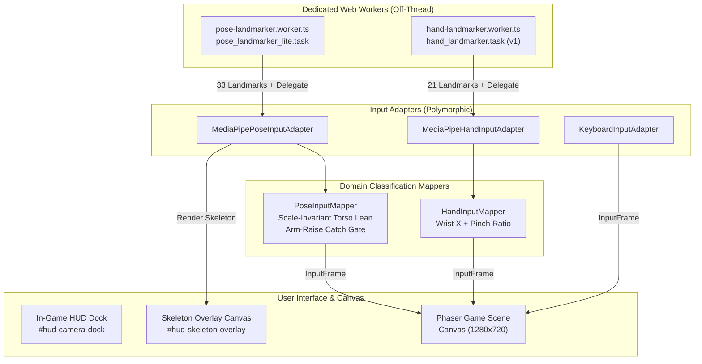

# Reactor Rush — Camera Input Integration

**Status:** CV-02 Live Observability & Multi-Modal Pose Integration; keyboard remains the default fail-safe input.

---

## 1. User Flow & Setup Experience

1. **Origin Requirements:** Start the app from `http://127.0.0.1:5173` or another HTTPS origin. Camera APIs are blocked by browser security on insecure network origins.
2. **Setup Trigger:** Choose **Set up webcam controls**. The application never requests camera permissions on initial page load.
3. **Tracking Scheme Selection:** Players choose their desired tracking mode:
   - **`HAND PINCH [H0]`**: Finger pinch catch; best for near desk-play (< 1.5m).
   - **`POSE BOTH ARMS [P1]` (Default)**: Torso lean movement + both arms raised catch; highly distinct, zero false catches at 2.0m–3.0m booth distance.
   - **`POSE ONE ARM [P2]`**: Torso lean movement + either arm raised catch; single-arm accessible, low physical exertion.
4. **Player Mode:** Select **1 PLAYER (SOLO)** or **2 PLAYERS (CO-OP)**.
5. **Consent & Privacy Notice:** Read and accept the camera notice. Click **Enable Camera & Load Model**. The browser requests video permissions only; microphone is never accessed.
6. **Calibration:**
   - **Hand Mode (`H0`)**: Hold hands near center of designated half. Click **Calibrate Both Hands**.
   - **Pose Mode (`P1`/`P2`)**: Stand side-by-side in camera framing: P1 Cyan on the left, P2 Pink on the right. System verifies both upper-body skeletons (shoulders, elbows, wrists, hips). Click **Calibrate Both Players**.
7. **In-Game Live Observability (HUD Dock):**
   - Active gameplay features a mirrored Picture-in-Picture (PiP) dock centered between player cards (`top: 16%`, `left: 50%`, `transform: translateX(-50%)`).
   - Real-time skeleton overlay with 33 landmarks, bone connections, and golden Catch trigger rings.
   - Dual status badges (e.g. `P1 TRACKING · CATCH`, `P2 MOVE LEFT`, `TOO CLOSE`, `CROSSING`, `P1 OUT OF FRAME`).
   - Minimize toggle (`V` keyboard shortcut or click) to collapse dock for full playfield visibility.
8. **Emergency Fallback & Teardown:** Stop camera input from the HUD dock or results screen to immediately resume keyboard controls (`A/D/S` for P1, `Left/Right/Down` for P2). Unchecking consent or encountering a camera error cleanly releases video tracks and Web Workers.

---

## 2. Runtime Architecture & Modularity

### 2.1. Scale-Invariant Torso Lean Mathematics (`PoseInputMapper`)
Unlike pixel-dependent tracking, the Pose mapper uses the player's own shoulder width to normalize movement, ensuring identical responsiveness regardless of player height or distance:

$$\text{leanNormalized} = \frac{\text{torsoX} - \text{neutralX}}{\text{shoulderWidth}}$$

Where:
- $\text{torsoX} = \frac{x_{\text{leftShoulder}} + x_{\text{rightShoulder}}}{2}$
- $\text{shoulderWidth} = |x_{\text{leftShoulder}} - x_{\text{rightShoulder}}|$
- **Enter Threshold:** $|\text{leanNormalized}| \ge 0.28 \implies \text{moveAxis} = \pm 1$
- **Release Threshold:** $|\text{leanNormalized}| \le 0.16 \implies \text{moveAxis} = 0$ (Hysteresis prevents jitter)

### 2.2. Catch Gesture Classification
- **Candidate P1 (`both_arms`):** Requires **both** wrists above shoulder level:
  $$y_{\text{leftWrist}} < y_{\text{leftShoulder}} - 0.05 \cdot h_{\text{torso}} \quad \text{AND} \quad y_{\text{rightWrist}} < y_{\text{rightShoulder}} - 0.05 \cdot h_{\text{torso}}$$
  - Release threshold: Either wrist falls below shoulder line ($y_{\text{wrist}} > y_{\text{shoulder}}$).
  - Eliminates accidental catches during lateral reaching or walking.
- **Candidate P2 (`one_arm`):** Requires **either** wrist above shoulder level:
  $$y_{\text{leftWrist}} < y_{\text{leftShoulder}} - 0.05 \cdot h_{\text{torso}} \quad \text{OR} \quad y_{\text{rightWrist}} < y_{\text{rightShoulder}} - 0.05 \cdot h_{\text{torso}}$$
  - Release threshold: Both wrists drop below shoulder line.

### 2.3. Anti-Silent-Swap Boundary Lock & Fail-Neutral Policy
- **Proximity Guard:** If two player torsos are closer than $0.15$ normalized screen distance, both are flagged with `'too-close'`, and inputs are immediately neutralized (`moveAxis=0`, `catch=false`).
- **Boundary Crossing Lock:** P1's torso center is strictly forbidden from crossing into the right half ($X > 0.52$), and P2 cannot cross into the left half ($X < 0.48$). Crossing triggers `'crossing'`, locks previous associations, and neutralizes controls until players return to their respective sides.
- **Stale Tracking Timeout:** If inference frames cease for $> 250\text{ ms}$, controls immediately return to neutral.
- **Calibration Recovery:** Temporary dropouts (e.g. participant stepping behind another person) preserve calibrated neutral points upon re-entry rather than requiring re-calibration.

---

## 3. Offline Booth Readiness & Provenance

- **100% Local Inference:** All vision bundles are hosted locally inside the application bundle:
  - Model 1: `public/mediapipe/hand_landmarker.task` (MediaPipe Hand Landmarker v1 float16).
  - Model 2: `public/mediapipe/pose_landmarker_lite.task` (MediaPipe Pose Landmarker Lite float16, 5,777,746 bytes; SHA-256: `59929E1D1EE95287735DDD833B19CF4AC46D29BC7AFDDBBF6753C459690D574A`).
  - WASM Engine: `@mediapipe/tasks-vision` WASM binaries located in `public/mediapipe/wasm/` (`vision_wasm_internal.*`, `vision_wasm_module_internal.*`, `vision_wasm_nosimd_internal.*`).
- **Zero External Requests:** Camera mode operates fully in Airplane Mode without external CDN, font, or telemetry requests.
- **Hardware Acceleration:** WebGL GPU delegate initialized with `OffscreenCanvas` warmup; automatically falls back to CPU if WebGL context is unavailable, reporting exact delegate state in telemetry.

---

## 4. Verification Suite & Evidence Hierarchy

1. **Automated Verification:**
   - 67 deterministic unit tests (`node --test tests/*.test.mjs`) pass with 0 failures:
     - `tests/item-cue.test.mjs` (4 tests)
     - `tests/round-scoring.test.mjs` (2 tests)
     - `tests/round-timer.test.mjs` (5 tests)
     - `tests/simulation.test.mjs` (8 tests)
     - `tests/keyboard-input-mapper.test.mjs` (1 test)
     - `tests/hand-input-mapper.test.mjs` (9 tests)
     - `tests/keyboard-input-adapter.test.mjs` (2 tests)
     - `tests/mediapipe-hand-input-adapter.test.mjs` (12 tests)
     - `tests/mediapipe-pose-input-adapter.test.mjs` (7 tests)
     - `tests/pose-input-mapper.test.mjs` (10 tests)
     - `tests/asset-manifest.test.mjs` (7 tests)
2. **Automated Build & Typecheck:**
   - `npm run typecheck` passes cleanly with 0 TypeScript errors.
   - `npm run build` compiles production assets in under 1.1 seconds.
3. **Chrome DevTools MCP Visual Inspection:**
   - 1280x720 and 1920x1080 viewport layouts verified with 0 overlapping controls.
   - Live camera dock placement verified with 18px clearance below round clock and 166px lateral clearance from player cards.
4. **Physical Benchmark Execution:**
   - On-site hardware tests on the Dell Vostro 15 5510 are conducted per [`cv-02-physical-benchmark-procedure.md`](./cv-02-physical-benchmark-procedure.md).
