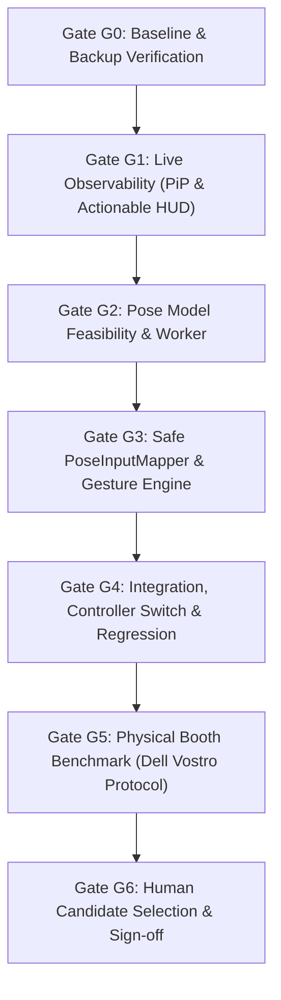

# Reactor Rush CV-02 — Autonomous Interaction Redesign & Verification Implementation Plan

**Status:** Awaiting User Review & Approval (Gate G0 Planning Phase)  
**Baseline Commit:** `39d026c17da586a577b3f67d76cceaa7b0a6c0ff` (Clean `main`)  
**Specification Reference:** [`CV02_AUTONOMOUS_PLAYBOOK.md`](file:///c:/Users/qnhat/Downloads/CV02_AUTONOMOUS_PLAYBOOK.md) & [`CV02_TEST_MATRIX.csv`](file:///c:/Users/qnhat/Downloads/CV02_TEST_MATRIX.csv)  
**Core Mission:** Resolve distance unresponsiveness and lack of live feedback by making current behavior observable during active gameplay, evaluating body-pose gestures (P1 both arms, P2 one arm) against the H0 hand pinch baseline, and enforcing strict session tracking and safety invariants across Gates G0 through G6.

---

## 1. Goal Description

Human playtesting revealed that after 4–5 rounds, the hand pinch catch was difficult at typical STEM Fair camera distances (~2–3m), the controls felt laggy or frozen, and players had no visible camera/gesture feedback during active play (the preview was hidden inside the setup modal). 

CV-02 addresses this through four core pillars:
1. **Live Observability (CV-02A / Gate G1):** Introduce a non-obstructing, mirrored Picture-in-Picture (PiP) preview and skeleton overlay during active gameplay, displaying real-time accepted controller states (`TRACKING`, `MOVE LEFT`, `MOVE RIGHT`, `CATCH`, `TOO FAR`, `OUT OF FRAME`, `AMBIGUOUS`, `LOST`, `KEYBOARD ACTIVE`) and actionable recovery cues.
2. **Gesture Candidate Comparison (CV-02B / Gate G2):** Evaluate body-scale gestures against baseline H0:
   - **H0 (Baseline Hand)**: Calibrated wrist delta for Move; pinch for Catch.
   - **P1 (Body Pose)**: Upper-body torso lean for Move; both wrists raised above shoulders for Catch.
   - **P2 (Body Pose)**: Upper-body torso lean for Move; one designated arm raised above shoulder for Catch.
3. **Safe Pose Mapper & Session Tracking (CV-02C / Gate G3):**
   - Match detected poses to calibrated P1/P2 by shoulder/torso center, never relying on raw MediaPipe array ordering.
   - Scale-invariant movement normalized to shoulder width (`distance(leftShoulder, rightShoulder)`).
   - Strict fail-neutral policy: crossing boundaries or losing confidence neutralizes inputs immediately, never silently swapping players.
4. **Integration, Regression & Hardware Protocol (Gates G4–G6):**
   - Seamless runtime controller selector (H0 vs P1 vs P2) preserving 100% offline booth readiness.
   - Zero gameplay semantics changes (scores, timer, collision, and Phaser character rigs remain untouched).
   - Honest evidence tiering: automated verification (`PASS`), browser simulation (`PASS`), target Dell hardware benchmark (`NOT RUN`).

---

## 2. User Review Required

> [!IMPORTANT]
> **No Game Mechanics Modification**:
> In accordance with Hard Rule 3 & 7, CV-02 preserves all existing Energy Catch gameplay semantics (60-second timer, orb spawn rates, hazard penalties, combo multipliers, and Phaser rig animations). Catch remains a boolean state (`catch: boolean`) evaluated against item catch-band overlap. If playtesting indicates that holding arms raised triggers unfair consecutive catches, any pulse/cooldown/one-shot catch change will be submitted as an independent Mechanics Change Request requiring separate human sign-off.

> [!WARNING]
> **Controller Selection Architecture**:
> To support rigorous A/B comparison without regressions, H0 Hand mode and Pose mode will coexist behind a clean controller toggle in the setup menu. Exactly one camera pipeline will run at any time (no dual-inference GPU resource contention).

> [!IMPORTANT]
> **Honest Evidence Classification**:
> Automated tests and headless browser runs will be classified as `PASS` when passing. All rows in `CV02_TEST_MATRIX.csv` requiring real participants or the physical Dell Vostro 15 5510 (`PO-07..09`, `FT-01..10`, `PF-01..08`) will be explicitly reported as `NOT RUN` until verified on-site.

---

## 3. Open Questions & Design Decisions

1. **In-Game PiP Placement**:
   - *Analysis*: In the 1280x720 playfield, P1 operates at X=95–565 and P2 at X=715–1185. Falling items spawn within player lanes only. The center strip between X=565 and X=715 (width 150px, expanding up to 200px at higher Y) has zero falling items and zero robot collisions.
   - *Proposal*: Position a compact 200x112px (16:9) live mirrored preview dock at top-center directly beneath the round clock (or in a floating semi-transparent HUD dock) with an operator visibility toggle (`V` key).
2. **Pose Model Selection**:
   - *Proposal*: Use official `pose_landmarker_lite.task` (5.77 MB, float16) from Google MediaPipe's official storage bucket. Lite provides the lowest latency (~15–25ms WebGL GPU inference on Intel Iris Xe) and leaves ample GPU budget for Phaser's 60 FPS rendering.
3. **One-Arm vs Both-Arm Catch (P1 vs P2)**:
   - Both P1 (two arms up) and P2 (one arm up) will be implemented as configurable profiles within `PoseInputMapper` to enable direct side-by-side field testing.

---

## 4. Phase & Gate Architecture



### Gate G0 — Baseline & External Backup
- Verify clean git status on `main` at `39d026c17da586a577b3f67d76cceaa7b0a6c0ff`.
- Create external hash-verified backup snapshot in `C:\Users\qnhat\_Project\ReactorRush-CV02-backups\baseline-39d026c`.
- Verify SHA-256 equality before touching any code.

### Gate G1 — Live Observability (CV-02A)
- Add mirrored live camera PiP dock to the active HUD during gameplay.
- Synchronize video mirroring and canvas skeleton transform (`scaleX(-1)`).
- Display per-player accepted controller state: `TRACKING`, `MOVE LEFT`, `MOVE RIGHT`, `CATCH`, `TOO FAR`, `OUT OF FRAME`, `AMBIGUOUS`, `LOST`, `KEYBOARD ACTIVE`.
- Verify baseline H0 Hand mode works seamlessly with live in-game PiP.

### Gate G2 — Pose Feasibility & Worker Pipeline (CV-02B)
- Download and verify official `pose_landmarker_lite.task` into `public/mediapipe/pose_landmarker_lite.task`.
- Record model card, license (Apache 2.0), file size (5,777,746 bytes), and SHA-256 in `public/mediapipe/NOTICE.md`.
- Implement `src/workers/pose-landmarker.worker.ts`:
  - WebGL `GPU` delegate with offscreen warmup canvas; fallback to `CPU`.
  - Max poses: `numPoses: 2`, `minPoseDetectionConfidence: 0.5`, `minTrackingConfidence: 0.5`.
  - Measures `inferenceMs` per frame and extracts 33 landmarks with `visibility` and `presence`.

### Gate G3 — Safe PoseInputMapper & Gesture Classification (CV-02C)
- Implement `src/adapters/pose-input-mapper.ts`:
  - **Pose Association**: Compute torso/shoulder center in mirrored space (`1 - rawX`). Match poses to calibrated territories; do not trust MediaPipe array indices.
  - **Scale-Invariant Movement**:
    $$\text{leanRatio} = \frac{\text{torsoX} - \text{neutralX}}{\text{shoulderWidth}}$$
    Hysteresis: Enter at $|\text{leanRatio}| \ge 0.22$, release at $|\text{leanRatio}| \le 0.12$.
  - **Catch Classification**:
    - Mode P1: Both wrists above shoulder line ($\text{wrist.y} < \text{shoulder.y} - 0.10 \times \text{shoulderWidth}$).
    - Mode P2: Either wrist above shoulder line ($\text{wrist.y} < \text{shoulder.y} - 0.15 \times \text{shoulderWidth}$).
    - Hysteresis: Wrist must cross back below shoulder line to release Catch.
  - **Anti-Silent Reassignment**: Temporal tracking against `lastKnownX`. If P2 crosses to P1 half, input is neutralized with `ambiguityReason = 'bodies-crossed'`.
  - **Proximity Guard**: If torso centers are within 0.14 distance, neutralize both with `ambiguityReason = 'bodies-too-close'`.
  - **Stale Tracking**: Stale after 250ms -> safe neutral.
- Implement `src/adapters/pose-landmarks-renderer.ts`:
  - Render 33-landmark skeleton (shoulders, elbows, wrists, hips, torso box).
  - Highlight wrists in gold when Catch is active.
- Implement `src/adapters/mediapipe-pose-input-adapter.ts`:
  - Implements `InputAdapter`.
  - Lifecycle: camera stream, worker communication, metrics tracking, calibration, cleanup.

### Gate G4 — Integration, Controller Toggle & Regression (CV-02D)
- In `src/main.ts` & `index.html`:
  - Add Tracking Scheme selector in Camera Setup modal:
    - `HAND PINCH (H0 BASELINE)`
    - `POSE: BOTH ARMS UP (P1)`
    - `POSE: ONE ARM UP (P2)`
  - Instantiate and start only the selected adapter pipeline.
  - Wire live in-game HUD PiP feedback to active adapter metrics.
- Verify 100% offline cold start (local model and `/mediapipe/wasm`).
- Run full regression suite (`node --test tests/*.test.mjs`, `npm run typecheck`, `npm run build`).

### Gate G5 — Physical Booth Benchmark Preparation
- Populate and resolve `CV02_TEST_MATRIX.csv` with automated test results.
- Create execution protocol `docs/gameplay/cv-02-physical-benchmark-procedure.md` for Dell Vostro 15 5510 on-site trial.
- Explicitly label all physical test rows (`FT-*`, `PF-*`) as `NOT RUN`.

### Gate G6 — Human Candidate Selection
- Present comprehensive comparison matrix (H0 vs P1 vs P2) with measured latencies, memory footprints, and tradeoffs.
- Stop for human decision on booth default gesture before any release.

---

## 5. Proposed File Changes

### Component 1: Model Assets & Documentation
- **[NEW]** [`public/mediapipe/pose_landmarker_lite.task`](file:///c:/Users/qnhat/_Project/Reactor%20Rush/public/mediapipe/pose_landmarker_lite.task) (Official Google MediaPipe Pose Landmarker model binary).
- **[MODIFY]** [`public/mediapipe/NOTICE.md`](file:///c:/Users/qnhat/_Project/Reactor%20Rush/public/mediapipe/NOTICE.md) (Record pose model provenance, license, size, SHA-256).

### Component 2: Pose Worker & Renderers
- **[NEW]** [`src/workers/pose-landmarker.worker.ts`](file:///c:/Users/qnhat/_Project/Reactor%20Rush/src/workers/pose-landmarker.worker.ts) (Isolated Web Worker running MediaPipe `PoseLandmarker` with GPU/CPU fallback, 2 poses max, inference duration measurement).
- **[NEW]** [`src/adapters/pose-landmarks-renderer.ts`](file:///c:/Users/qnhat/_Project/Reactor%20Rush/src/adapters/pose-landmarks-renderer.ts) (Draws 33-point body skeleton, torso box, and gold Catch activation cues on mirrored preview canvas).

### Component 3: Pose Mapping & Adapter
- **[NEW]** [`src/adapters/pose-input-mapper.ts`](file:///c:/Users/qnhat/_Project/Reactor%20Rush/src/adapters/pose-input-mapper.ts) (Pure deterministic mapper: pose association, body-normalized lean, hysteresis, configurable P1/P2 catch, anti-silent reassignment, fail-neutral ambiguity).
- **[NEW]** [`src/adapters/mediapipe-pose-input-adapter.ts`](file:///c:/Users/qnhat/_Project/Reactor%20Rush/src/adapters/mediapipe-pose-input-adapter.ts) (`InputAdapter` implementation owning Pose worker, camera stream, calibration, and live metrics).

### Component 4: Live Observability & UI
- **[MODIFY]** [`index.html`](file:///c:/Users/qnhat/_Project/Reactor%20Rush/index.html) (Add live PiP dock `#hud-camera-dock` inside `#active-hud`, controller mode selector inside `#camera-setup-screen`).
- **[MODIFY]** [`src/game-style.css`](file:///c:/Users/qnhat/_Project/Reactor%20Rush/src/game-style.css) (Styles for `#hud-camera-dock`, PiP sizing, skeleton alignment, and live status badges).
- **[MODIFY]** [`src/main.ts`](file:///c:/Users/qnhat/_Project/Reactor%20Rush/src/main.ts) (Manage live PiP during gameplay, toggle between Hand and Pose adapters, update real-time gesture feedback in HUD).

### Component 5: Tests & Benchmark Documentation
- **[NEW]** [`tests/pose-input-mapper.test.mjs`](file:///c:/Users/qnhat/_Project/Reactor%20Rush/tests/pose-input-mapper.test.mjs) (Unit tests for `GS-*` and `ID-*` test families: lean thresholds, hysteresis, P1/P2 catch, anti-silent swap, proximity, teleport, solo/coop switch).
- **[NEW]** [`tests/mediapipe-pose-input-adapter.test.mjs`](file:///c:/Users/qnhat/_Project/Reactor%20Rush/tests/mediapipe-pose-input-adapter.test.mjs) (Adapter lifecycle tests: startup, cancellation, stale tracking, offline paths, CPU fallback, resource cleanup).
- **[NEW]** [`docs/gameplay/cv-02-physical-benchmark-procedure.md`](file:///c:/Users/qnhat/_Project/Reactor%20Rush/docs/gameplay/cv-02-physical-benchmark-procedure.md) (Physical hardware protocol and template for Dell Vostro 15 5510).
- **[MODIFY]** [`docs/gameplay/camera-input-integration.md`](file:///c:/Users/qnhat/_Project/Reactor%20Rush/docs/gameplay/camera-input-integration.md) (Reconcile CV-02 dual-controller architecture and PiP observability).

---

## 6. Verification Plan

### Automated Test Suite
- Run full test suite:
  ```powershell
  npm test
  ```
  Expected: All 51 existing CV-01 tests PASS + ~25 new `pose-input-mapper` and `mediapipe-pose-input-adapter` tests PASS (~76 total tests).
- Typecheck & Production Build:
  ```powershell
  npm run typecheck
  npm run build
  ```
  Expected: 0 TypeScript errors, bundle completes with pose worker and model assets included.

### Browser & DevTools Verification
- Verify via Chrome DevTools MCP:
  - Game startup without camera: 0 camera requests, keyboard functional.
  - Camera setup: mode selection (Hand vs Pose P1 vs Pose P2).
  - In-game PiP dock: active during gameplay, mirrored video & canvas overlay aligned, zero overlap with score cards or falling items.
  - Console inspection: 0 errors, 0 warnings.
- Cold-start offline test:
  - Load production preview with network disconnected: verify local `/mediapipe/wasm` and local `.task` load without 404s.

### Test Matrix Resolution
- Update and populate `CV02_TEST_MATRIX.csv` with exact results, build SHA, and test commands.
- Mark physical hardware tests honestly as `NOT RUN`.

---

## 7. Rollback Plan
- External backup snapshot created in `C:\Users\qnhat\_Project\ReactorRush-CV02-backups\baseline-39d026c`.
- Revertable via `git checkout -- .` and removing newly added untracked files if needed.
